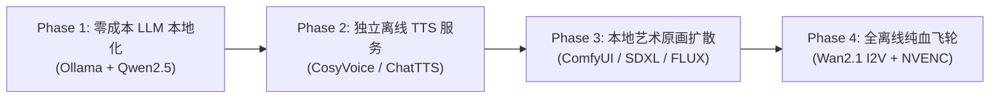

# ADR-015: 本地化 AI 演进路线与 NVIDIA RTX 4070 (12GB) 硬件适配架构

## 状态 (Status)
**Proposed / Roadmap (规划中 · 演进路线 · 2026-10-12)**

## 日期 (Date)
2026-10-12

---

## 1. 背景与上下文 (Context)

### 1.1 现状与依赖分析
当前 `HowToLiveBetter-Motion` 短视频自动化流水线在系统架构上采用了“云端多模态推理 + 本地轻量音画编排”的组合模式：
- **云端服务**：文案与黄金 6 幕分镜由 `muse-spark` 生成，高清原画由 `muse-image` 生成，语音解说依托 Cloudflare Workers Edge-TTS (`zh-CN-YunzeNeural`)，物理微动预留 `muse-video`。
- **本地编排**：由基于 Python 的 MoviePy 2.x、Pillow 和 imageio-ffmpeg 执行音频音量规整、字幕图层渲染、Ken Burns 运镜变换以及基于 CPU 的 H.264 软件编码导出。

### 1.2 运维手册未强制显卡的原因
在 [`docs/OPERATIONS_MANUAL.md`](file:///c:/develop/HowToLiveBetter-Motion/docs/OPERATIONS_MANUAL.md) 第 1.1 节中，运行环境仅列出 **CPU（4核以上）** 与 **内存（8GB RAM 以上）**，未对显卡作出强制性指标。其核心考量在于：
1. **零环境负担**：使用者无需在本地安装数十 GB 的 CUDA Toolkit、cuDNN、PyTorch 深度学习运行时或巨型检查点模型；
2. **低并发单条生产**：在创作者“日常单条生成、即时复核”的工作习惯下，CPU 软编约 15~25 秒的耗时完全在可接受区间内；
3. **云端 API 极低试错成本**：依托标准 OpenAI 格式接口，便于轻量化敏捷验证。

### 1.3 本地化演进的驱动力
随着内容体量从单篇扩展至全书 677 篇批量流水线，或面临以下场景时，纯云端架构存在天然上限：
- **API 额度与长期成本**：全量 677 篇需生成超 4,000 幅原画、4,000 段音频；若未来全面推行 I2V（图生视频微动），云端账单将大幅增加；
- **网络波动与依赖风险**：海外 CDN 与第三方 API 偶尔遭遇超时、HTTP 429 限流或服务降级；
- **数据自主与艺术控制力**：创作者本地拥有定制画风 LoRA、微调模型与离线私有化知识库的强烈诉求。

### 1.4 本机硬件画像 (Hardware Profile)
创作者工作站已实测具备高度理想的深度学习与多媒体生产硬件基石：
- **GPU**：NVIDIA GeForce RTX 4070（Ada Lovelace 架构，5888 CUDA 核心，第 8 代 NVENC 双编码器，配备 **12GB GDDR6X 独立显存**）；
- **主机内存**：**32GB RAM**（高吞吐双通道）；
- **存储与多媒体**：已集成支持 `h264_nvenc` / `hevc_nvenc` / `av1_nvenc` 的 FFmpeg 7.1 运行时。

在消费级 AI 硬件中，**12GB 显存是运行高质量量化大模型、先进扩散生图、高保真语音克隆与轻量视频微动的黄金甜点位（Sweet Spot）**。

---

## 2. 架构设计与显存预算 (Architecture & VRAM Budget)

### 2.1 核心约束：分阶段单模型加载-释放 (Sequential Lifecycle)
由于 12GB 显存无法同时常驻 7B LLM + FLUX 生图 + I2V 视频模型，流水线必须遵循 **“串行作业、阶段加载、用毕释放（Load-on-Demand & Clean-up）”** 原则。配合主机 32GB 内存，可利用 CPU 内存作为模型交换的缓冲池：

```
[阶段 1: LLM 分镜脚本]  ──► 显存占用: ~5.5GB (Q4)  ──► 输出: storyboard.json ──► 释放模型显存
           │
           ▼
[阶段 2: 本地 TTS 语音]   ──► 显存占用: ~2.5GB      ──► 输出: voice_*.mp3     ──► 释放模型显存
           │
           ▼
[阶段 3: 本地艺术原画]   ──► 显存占用: ~8.5GB      ──► 输出: scene_*.png     ──► 释放模型显存
           │
           ▼
[阶段 4: 本地 I2V 微动]   ──► 显存占用: ~9.5GB (FP8) ──► 输出: motion_*.mp4    ──► 释放模型显存
           │
           ▼
[阶段 5: NVENC 视频组装]  ──► 显存占用: < 0.5GB     ──► 输出: 成片 MP4         ──► 极速 2s 压制
```

---

## 3. 本地化多模态技术选型矩阵 (Tech Stack Selection)

为确保本地化演进**不破坏现有流水线的数据契约**，所有本地 AI 选型均严格遵循 **“标准协议平替（Drop-in Replacement）”**，业务代码只需微调环境变量即可无缝切换：

| 模块 | 现有云端方案 | 推荐本地化开源模型 | 本地运行时/引擎 | 12G 显存预算与量化 | 接口平替方式 |
| :--- | :--- | :--- | :--- | :--- | :--- |
| **文案与分镜 (LLM)** | `muse-spark` | **Qwen2.5-7B-Instruct** 或 **DeepSeek-R1-Distill-Qwen-8B** | **Ollama** / **vLLM** / llama.cpp | Q4_K_M (~4.8GB)<br>Q8_0 (~8.0GB) | 暴露 OpenAI 兼容接口 (`localhost:11434/v1`)，仅需在 `.env` 中修改 `MUSE_BASE_URL`，**代码 0 侵入**。 |
| **解说配音 (TTS)** | Cloudflare Edge-TTS (`YunzeNeural`) | **CosyVoice-300M** (阿里开源) 或 **ChatTTS** / **Fish-Speech** | Python FastAPI 本地微服务 | FP16 (~2.5GB) | 封装为兼容 OpenAI 的 `/v1/audio/speech` 端点，支持音色克隆与情感标记。 |
| **艺术原画 (T2I)** | `muse-image` | **FLUX.1-schnell** (8-step) 或 **SDXL + LoRA** | **ComfyUI API** 或 Diffusers | FLUX NF4/Q4 (~8.5GB)<br>SDXL FP16 (~6.5GB) | 提供标准图片生成 Web API，单张 1024×1792 生成耗时 4~7 秒。 |
| **动态微动 (I2V)** | `muse-video` | **Wan2.1 (1.3B / 14B-Q4)** 或 **SVD-XT (Stable Video Diffusion)** | ComfyUI / Diffusers | FP8 / GGUF (~9.5GB) | 接收首帧 PNG 与 motion prompt，导出 2~3 秒 1080P 物理微动切片。 |
| **视频组装编码** | CPU 软编 (`libx264`) | **NVIDIA NVENC (`h264_nvenc`)** | 本机 FFmpeg 7.1 | 显存占用 < 500MB | MoviePy `codec="h264_nvenc"`，导出提速 3~5 倍，CPU 占用降为近乎 0。 |

---

## 4. 渐进式实施路线图 (Phased Implementation Roadmap)

建议采取分阶段平滑演进策略，由易到难，保持主干流水线时刻可用：



### 阶段一：LLM 文案与分镜本地化（预计改造工时：15 分钟）
- **实施操作**：
  1. 安装 Windows 版 [Ollama](https://ollama.com/)；
  2. 运行终端命令拉取国产标杆大模型：
     ```powershell
     ollama run qwen2.5:7b
     ```
  3. 修改项目 `.env` 配置文件：
     ```ini
     MUSE_BASE_URL=http://localhost:11434/v1
     MUSE_API_KEY=ollama
     MODEL_TEXT=qwen2.5:7b
     ```
- **收益**：分镜规划与营销文案生成完全脱网运行，无 API 成本，响应延迟低于 2 秒。

### 阶段二：解说语音 TTS 本地私有化（预计改造工时：1~2 小时）
- **实施操作**：
  1. 部署开源 `CosyVoice` 或轻量 `edge-tts-server`；
  2. 提取一段 10 秒的高清人声样本（如成熟沉稳的知识博主音色），训练音色锚点；
  3. 将 `.env` 中的 `TTS_API_URL` 指向本地容器或 Python 进程。
- **收益**：彻底摆脱对 Cloudflare 网络连通性的依赖，获得更具质感的情感起伏与咬字控制。

### 阶段三：艺术原画与画风 LoRA 本地化（预计改造工时：半天）
- **实施操作**：
  1. 基于 ComfyUI 搭建 1024×1792 竖屏工作流；
  2. 针对项目专属的 7 款风格卡（吉卜力、Vox、Kurzgesagt、水墨等）挂载社区优质 LoRA 权重；
  3. 编写 `src/local_image_client.py` 适配 ComfyUI `/prompt` WebSocket 接口。
- **收益**：彻底实现艺术原画高清掌控，无水印、无调用计费、画风一致性通过 LoRA 得到数学级锁定。

### 阶段四：纯血离线自动化飞轮（终态）
- **实施操作**：
  1. 挂载本地 I2V 模型执行物理微动运算；
  2. 流水线激活 NVENC 硬件编码；
  3. 实现一键脚本无网环境下从 Markdown 知识库全自动批量生产成片。

---

## 5. 收益与权衡对比 (Consequences & Trade-offs)

### 正向收益 (Pros)
1. **零边际成本**：677 篇内容、上千条短视频批量导出不再产生 API 费用；
2. **绝对断网可用**：在离线或极端弱网环境下，全自动装配依然能平稳运转；
3. **画风与音色独占性**：可自由加载专有 LoRA、微调底模与专属克隆音色，建立高壁垒的内容 IP 辨识度；
4. **性能极致释放**：充分盘活工作站 32GB 内存与 RTX 4070 12GB 显卡的硬件价值。

### 潜在代价与挑战 (Cons & Mitigation)
1. **显存峰值管理挑战**：若多个模型未及时释放可能引发 CUDA Out of Memory (OOM)。
   - *对策*：流水线各 step 间显式调用 `torch.cuda.empty_cache()` 并执行进程级隔离调度。
2. **首次部署与存储体积**：本地检查点文件（GGUF、Safetensors）累计需 20~40GB 磁盘空间。
   - *对策*：利用本机高速 NVMe SSD 独立划分子目录存储模型权重。

---

## 6. 相关决策与文档关联 (References)
- [`docs/OPERATIONS_MANUAL.md`](file:///c:/develop/HowToLiveBetter-Motion/docs/OPERATIONS_MANUAL.md)：系统软硬件基础配置与运维手册
- [`docs/system_design.md`](file:///c:/develop/HowToLiveBetter-Motion/docs/system_design.md)：端到端架构总览与多模态数据契约
- [ADR-004](file:///c:/develop/HowToLiveBetter-Motion/docs/decisions/ADR-004-Edge-TTS-Integration-and-Audio-Driven-Timing.md)：TTS 语音解说接入与「以声定景」动态音画同步
- [ADR-010](file:///c:/develop/HowToLiveBetter-Motion/docs/decisions/ADR-010-I2V-Hybrid-Motion-Architecture.md)：图生视频 (I2V) 混合动态微动架构
