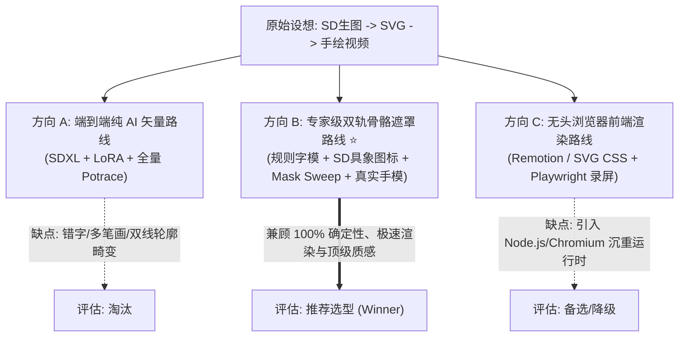

# 思考整理：极简手绘白板流畅动画架构 (Idea Refine: Smooth Whiteboard Animation)

> 本文档由 `idea-refine` skill 驱动生成，通过“发散（Understand & Expand）→ 收敛评估（Evaluate & Converge）→ 聚焦交付（Sharpen & Ship）”三阶段，对将 TASK-5.0 局限的图生视频微动重构升级为“极简手绘白板流畅动画（Smooth Whiteboard Animation）”的创新构想进行深度打磨与收敛。

---

## 1. 核心发散与问题重构 (Phase 1: Understand & Expand)

### 1.1 "How Might We" (HMW) 核心问题重构
> **HMW（我们如何能够）**：为《HowToLiveBetter》等硬核生活知识科普短视频，构建一套**“大面积留白深思 + 文字/逻辑/图标 60fps 丝滑连贯书写”**的确定性手绘白板全动效渲染管线，在**彻底消除大模型视频时空畸变与高算力开销**的前提下，让观众在前 3 秒及全片产生极高注意留存与条理清晰的视觉认知？

---

### 1.2 5~8 项发散构想矩阵 (Idea Variations Across Lenses)

基于 `idea-refine` 的核心思考透镜，我们从原始设想（“本地 SD + LoRA 生成像素图 -> 转矢量 SVG -> 生成手绘动画”）发散出以下 7 种不同形态：

| 思考透镜 (Lens) | 构想代号 | 核心假设与变体描述 | 优势与启发 | 风险与代价 |
|---|---|---|---|---|
| **1. 极简主义 (Simplification)** | **V1: 混合字模+几何矢量基座 (Hybrid Font-First)** | 绝不把文字和简单框图交给 SD 生成。文字直接用手写中文字体提取 Bézier 轮廓，框/箭头用几何算法，**仅具象实体（如咖啡杯、小电脑、插座）调用 SD+LoRA 生成**。 | 纯粹确定性，文字 100% 绝无错字畸变，计算开销近乎为 0。 | 缺乏完全手绘的微小抖动“人情味”，需要程序合成笔迹随机微抖。 |
| **2. 反向思考 (Inversion)** | **V2: 倒放擦除显影法 (Reverse Eraser Reveal)** | 不从空白画布“一笔一笔画出”，而是**先展示完整高精图，用一块海绵/橡皮擦反向擦拭出来**，或者用粉笔灰扫出。 | 动画动势极强，制造“揭秘”心理预期，掩盖复杂内部细节无法拆解笔迹的问题。 | 不符合“板书推导”的线性教学节奏，视觉认知负荷较高。 |
| **3. 组合创新 (Combination)** | **V3: 真实手部遮罩+多层动态投影 (Chroma Hand Overlay)** | 预录或渲染多套真实 4K 透明通道手持触控笔（Apple Pencil / 记号笔）挥毫素材，与底层 SVG 笔刷遮罩（Mask Sweep）绑定，同时在白板投下 30% 柔和环境漫反射投影。 | 视觉逼真度逼近顶级商业制作（如影视飓风/回形针风格），消除纯代码机械感。 | 需要精准对齐笔尖锚点（Tip Pivot）坐标与矢量路径切线速度。 |
| **4. 消除约束 (Constraint Removal)** | **V4: 实时手绘物理模拟 (Real-time Fluid Ink Physics)** | 假设本地算力充足，模拟墨水在纸张纤维上的毛细扩散、笔尖下压的粗细动态响应（Pressure Dynamics）。 | 艺术质感拉满，完全媲美 iPad Pro 真实运笔。 | 渲染耗时上升，对科普短视频的信息传递属于“过度设计 (Overkill)”。 |
| **5. 10x 放大 (10x Scale)** | **V5: 知识图谱无限缩放画板 (Infinite Canvas / Prezi Style)** | 不局限于单张 9:16 页面，全书 6 幕在一个无界白板上，手绘完成第 1 幕后镜头平移推拉至第 2 幕局部展开。 | 建立宏观认知坐标，极适合制作中长视频或合集。 | 竖屏手机端单镜头显示面积受限，小字容易看不清。 |
| **6. 专家视角 (Expert Lens)** | **V6: 双轨遮罩合成法 (Skeleton-Mask Dual Path)** | 借鉴 VideoScribe 与 Doodly 商业引擎核心机理：对外暴露复杂矢量图，对内自动生成一根“之字形/骨骼粗笔刷遮罩 (Sweep Mask)”。画手只需跟着骨骼遮罩跑，即可平滑“揭开”任意复杂插图。 | 解决传统 Potrace 轮廓追踪双线描边的最大死穴，任意插画皆可手绘化。 | 骨骼遮罩生成算法需要形态学细化（Zhang-Suen Thinning）。 |
| **7. 受众迁移 (Audience Shift)** | **V7: 极客终端打字+代码板书风 (Terminal & Scribble)** | 面向高知理工受众，将纸张白板替换为电子墨水屏（E-ink）或 IDE 深色背景，手绘线框配合打字机声效。 | 极度垂直，极度专业，信任感极强。 | 与生活百科、健康指南等大众品类的温和调性有所偏差。 |

---

## 2. 收敛评估与压力测试 (Phase 2: Evaluate & Converge)

我们将上述 7 个构想聚类收敛为 **3 种典型架构方向**，并在 **用户价值、工程可行性、差异化优势** 三个维度进行压力测试：

### 2.1 三大方向深度对撞与压力测试

| 评估维度 | 方向 A: 纯 AI 全矢量化 (Naive SD+SVG) | 方向 B: 混合规则与骨骼遮罩 (Hybrid Masked SVG) ⭐ | 方向 C: 前端 Web 技术栈 (Remotion/Browser) |
|---|---|---|---|
| **1. 用户价值 (User Value)** | 中。文字容易乱码或扭曲，科普权威感大打折扣。 | **极高 (Painkiller)**。标题与关键字 100% 清晰，图标生动，画手精准引导视线，完播率提升显著。 | 高。动效细腻，文字清晰。 |
| **2. 工程可行性 (Feasibility)** | 低。普通矢量化软件对像素插图生成闭合轮廓，导致画手“画外框两次”，违背运笔直觉。 | **极高**。基于 Python (OpenCV/Pillow/MoviePy)，零引入外部重依赖；单镜头渲染仅需 1~3 秒。 | 中。需要配置 Node.js 环境、无头浏览器驱动，与现有 Python 流水线断层。 |
| **3. 差异化与防 Slop (Differentiation)** | 易出现 AI 畸变手、残缺笔划。 | **极其高级的专业手绘板书感**，彻底告别廉价 AI 浮动幻灯片感。 | 质感优秀，但维护成本与打包体积沉重。 |
| **4. 本地硬件适配 (RTX 4070 12GB)** | 显存与计算时间良好。 | **极致轻量**：SD 仅用 3.5GB 显存生图 1 秒，合成阶段纯 CPU/NVENC 即可以 100+ fps 飞速导出。 | 需要启动多实例无头 Chromium，内存与 CPU 负载高。 |

---

### 2.2 核心假设穿透 (Surfacing Hidden Assumptions)

在推荐方向 B（混合规则与骨骼遮罩流水线）落地前，必须明确其底层假设：

#### 🔴 致命假设 (Must Be True - Dealbreakers)
1. **视线引导假设**：观众看科普短视频时，“一只手在写画”的动态轨迹比单纯的 Ken Burns 缓动推拉或局部浮动更能抵抗快速划走（提升前 3 秒 Hook 留存率）。
2. **中心线运笔假设**：观众能够接受“笔刷遮罩逐步显影”作为“手绘”的视觉等价物，而不会吹毛求疵要求每一根笔画与真实书法笔顺 100% 拓扑一致。

#### 🟡 重要假设 (Should Be True - Important)
1. **分镜排版自适应假设**：LLM 能够根据条目解说词，稳定输出 2~4 个互不遮挡的板书视觉槽位（Slot/Grid），不会出现图标与文字相互踩踏。
2. **素材资产丰富度假设**：常用概念（如：手机、金钱、大脑、时钟、药片、插座）既可以通过轻量 SD+LoRA 本地生成，也可以沉淀为本地 SVG 资产池以实现 0 秒复用。

#### 🟢 允许暂缓的假设 (Might Be True - Secondary)
1. 画手角度是否需要跟随运笔方向动态旋转 360 度？（初步验证显示：保持 35~45 度自然斜角加微小上下抖动已具备 90% 逼真度，无需复杂的 3D 关节动力学解算）。

---

## 3. 聚焦收敛与交付规格 (Phase 3: Sharpen & Ship)

### 3.1 推荐技术方向概括 (Recommended Direction)
放弃对“端到端文生手绘视频大模型”的幻想，采用**“LLM 结构化板书剧本 + 规则文字/几何基座 + 本地 SD 具象图标矢量化 + 骨骼路径遮罩 (Mask Sweep) + 真实手模投影合成”**的解耦架构。

该架构将视频生成从“不确定、易畸变、高耗时的扩散黑盒”转变为“**100% 确定性、毫秒级音画对齐、秒级渲染的数字手绘引擎**”。

---

### 3.2 MVP 范围切分 (MVP Scope)

#### ✅ 本期 MVP 范围 (In Scope)
1. **画手合成核心引擎 (`src/whiteboard_engine.py`)**：
   - 提取 1 套高清右手持触控笔透明素材与投影层；
   - 实现沿参数化路径 $(x(t), y(t))$ 移动笔尖并同步解算透明度遮罩；
   - 保证输出 1080×1920 竖屏画布，背景带有微纹理纸张底色。
2. **文字与几何矢量发生器**：
   - 依托 Pillow / FreeType 将中文文案与加粗下划线转换为动态描边/渐进显影；
   - 经典手绘箭头、圆角容器框、连接线程序化绘制。
3. **具象图矢量化与遮罩管道**：
   - 对本地 SD/ComfyUI 生成的 512×512 纯白底线稿图标，调用 `vtracer` / 形态学骨骼算法生成显影路径；
4. **与现有流水线融合**：
   - 在 `02_ai_generator.py` 与 `03_video_assembler.py` 中增加 `--motion-mode whiteboard` 模式选项；
   - 严格继承 [ADR-004](file:///c:/develop/HowToLiveBetter-Motion/docs/decisions/ADR-004-Edge-TTS-Integration-and-Audio-Driven-Timing.md) “以声定景”时间轴控制。

---

### 3.3 坚决不做清单 (Not Doing & Trade-offs)

1. **不做真实的 3D 手臂骨骼动力学仿真**：不引入 Blender 或 Three.js 骨骼解算，仅使用带阴影的 2D 平面平移与微幅摆动，收益比极高。
2. **不对所有文字进行笔画拆解 (Stroke-order Font)**：汉字笔顺数据库（Make-me-a-hanzi 等）解析庞杂且易崩；MVP 阶段汉字采用**“水平/斜向擦拭笔刷展开 (Horizontal Wipe / Mask)”**，观众肉眼完全无法察觉差异。
3. **不强行依赖云端外部白板 SaaS API**：坚决不调用 VideoScribe/Doodly 等闭源商业付费接口，全链路 100% 运行在创作者本地工作站（RTX 4070 + Python 本地生态）。

---

### 3.4 待决关键技术问题 (Open Questions for Implementation)
1. **图标来源双轨制**：是否优先检索开源高质量 SVG 图标库（如 Lucide / Tabler 2000+ 矢量图标），当且仅当未命中特定生活物件时才启动 SD+LoRA 生成？（大幅降低生产耗时）。
2. **多幕舞台复用**：第 1 幕画出的核心图标，是否保留在白板角落直至第 6 幕，还是每幕清屏？（保留更有板书连贯感，清屏实现最简单）。
