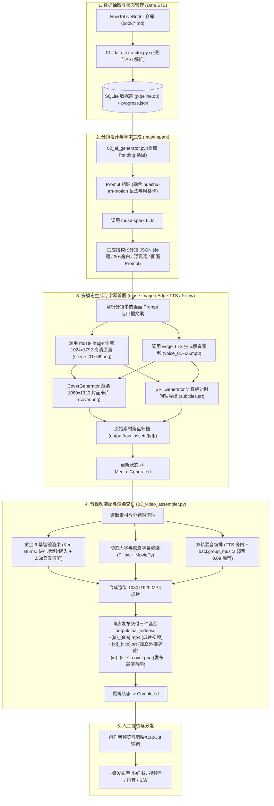

# 「高性价比人生指南」全自动短视频生成流水线系统设计文档
*(HowToLiveBetter-Motion Architecture & System Design)*

---

## 1. 系统概述与整体架构

### 1.1 项目背景与目标
本项目旨在打造一套工业级、端到端的全自动短视频内容生成流水线：
- **数据源**：源自开源知识库 [`HowToLiveBetter`](https://github.com/eternity4719/HowToLiveBetter)（收录 677 条严谨论证、高性价比的人生行动指南，包含成本、收益、说人话、证据等级等结构化信息）。
- **美学与叙事风格**：深度融入 [`huashu-art-motion`](https://github.com/alchaincyf/huashu-art-motion) 的“艺术风格配方卡”与“脉冲解说动画语法”设计哲学，坚决杜绝低质廉价的 AI Slop（无脑蓝紫霓虹、抽象悬浮图标、匀速慢推 PPT 感）。
- **AI 赋能引擎**：基于 Muse AI 开放平台（OpenAI SDK 协议兼容，BaseURL: `https://yourselfai.org/muse/v1`），调用 `muse-spark` 生成精炼口播与结构化分镜，调用 `muse-image` / `muse-video` 生成多模态视觉素材。
- **合成与交付**：30 秒以内黄金时长竖屏（9:16，1080×1920）高质感短视频，集成智能排版动态浮现字幕、配乐（BGM）对齐，输出至 `output/final_videos/` 供人工审核并分发至小红书、微信视频号、抖音等主流平台。

### 1.2 端到端流水线流程图


---

## 2. 本地状态管理与数据库 Schema 设计

全自动流水线面临网络波动、大模型 API 限流、多素材并行生成与断点续传的需求。采用 **SQLite + 自动镜像 `progress.json`** 的双轨持久化设计：
- **SQLite (`pipeline.db`)**：主数据源，利用 ACID 事务与行级锁保证并发抓取和生成时的可靠性，支持复杂过滤与查询。
- **`progress.json`**：轻量级镜像快照，方便人类开发者通过文本编辑器直观查看全局进度概览与快速调试。

### 2.1 SQLite 数据表 DDL 设计

```sql
-- 核心条目状态主表
CREATE TABLE IF NOT EXISTS entries (
    id VARCHAR(32) PRIMARY KEY,                  -- 全局唯一条目ID，如 "01_001", "05_045"
    source_file VARCHAR(128) NOT NULL,          -- 来源文件，如 "01-不要早死.md"
    chapter_index INTEGER NOT NULL,             -- 章节序号，如 1
    chapter_title VARCHAR(128) NOT NULL,         -- 章节标题，如 "不要早死"
    item_index INTEGER NOT NULL,                -- 条目序号，如 1
    title VARCHAR(256) NOT NULL,                -- 条目标题，如 "系安全带，前排后排都系"
    cost_money VARCHAR(32),                     -- 成本标签：钱 (0 / 少 / 中 / 多)
    cost_time VARCHAR(32),                      -- 成本标签：时间 (少 / 中 / 多)
    cost_willpower VARCHAR(32),                 -- 成本标签：毅力 (否 / 些 / 强)
    benefit_level VARCHAR(32),                  -- 成本标签：收益 (大 / 中)
    benefit_metric VARCHAR(64),                 -- 成本标签：口径 (如 "死亡率")
    
    cost_desc TEXT,                             -- 原文：成本描述
    plain_text TEXT,                            -- 原文：说人话
    benefit_desc TEXT,                          -- 原文：收益详情
    evidence_grade VARCHAR(8),                  -- 证据等级 (A / B / C)
    source_citations TEXT,                      -- 原文文献与法规来源
    notes TEXT,                                 -- 原文备注
    
    status VARCHAR(32) NOT NULL DEFAULT 'Pending', 
    -- 状态流转机枚举：
    -- 'Pending'            : 刚抽取入库，待处理
    -- 'Script_Generated'   : 已完成大模型脚本与分镜生成
    -- 'Media_Generated'    : 已完成图像/视频素材生成并保存在本地
    -- 'Video_Assembled'    : 已完成音视频剪辑渲染
    -- 'Completed'          : 质检通过，已归档
    -- 'Failed'             : 任何阶段异常失败，需介入重试

    script_json TEXT,                           -- muse-spark 生成的完整结构化分镜 JSON
    raw_assets_dir VARCHAR(512),                -- 生成的原始图片/视频素材存放目录
    final_video_path VARCHAR(512),              -- 最终合成的 MP4 文件绝对路径
    retry_count INTEGER DEFAULT 0,              -- 失败重试次数
    error_message TEXT,                         -- 最近一次错误堆栈记录
    created_at TIMESTAMP DEFAULT CURRENT_TIMESTAMP,
    updated_at TIMESTAMP DEFAULT CURRENT_TIMESTAMP
);

-- 创建索引以优化状态过滤与断点续传检索
CREATE INDEX IF NOT EXISTS idx_entries_status ON entries(status);
CREATE INDEX IF NOT EXISTS idx_entries_chapter ON entries(chapter_index);
```

### 2.2 结构化分镜输出协议 (`script_json` Schema)
大模型 `muse-spark` 生成的脚本必须严格遵循以下 JSON Schema：

```json
{
  "entry_id": "01_001",
  "video_title": "不要早死之系安全带，前排后排都系",
  "target_duration_sec": 28,
  "art_style_id": "25_ghibli",
  "art_style_name": "吉卜力暖调手绘风格",
  "color_palette": ["#2C3E50", "#E67E22", "#ECF0F1", "#27AE60"],
  "narration_text_full": "坐前排系安全带，撞车时致命风险直接砍半；但你知道吗？第二排不系带，被撞死的人里足足有六成！花两秒扣紧，就能保住命。",
  "scenes": [
    {
      "scene_index": 1,
      "time_range": "0.0-4.0",
      "duration_sec": 4.0,
      "narration_segment": "坐小汽车前排系上安全带，致命风险能直接降一半。",
      "primary_subject": "一双手敏捷扣入安全带卡扣，清脆锁止",
      "visual_action": "镜头快推特写，卡扣咬合瞬间泛起反光，清晰的安全带织物斜纹",
      "kinetic_typography": {
        "text": "风险降50%",
        "style": "slam_in",
        "position": "center_high"
      },
      "image_prompt": "A close-up shot of hands buckling a car seat belt securely with a distinct click, detailed fabric texture of the black strap, warm cinematic sunlight through the car window, Ghibli hand-drawn aesthetic, high detail, clean composition, 9:16 vertical ratio",
      "video_motion_prompt": "Camera quick punch-in zoom onto the belt buckle locking, sharp physical motion, ambient dust particles in sunlight"
    },
    {
      "scene_index": 2,
      "time_range": "4.0-12.0",
      "duration_sec": 8.0,
      "narration_segment": "但绝大多数人不知道，第二排如果不系，致命伤害风险暴增60%！",
      "primary_subject": "汽车后排乘客座位的真实空镜与后排安全带自然垂挂",
      "visual_action": "镜头微幅平移，红圈高亮标识后排位置",
      "kinetic_typography": {
        "text": "后排不系 60%致命",
        "style": "highlight_box",
        "position": "center"
      },
      "image_prompt": "Back seat of a modern passenger car, empty seating with hanging seatbelt, gentle warm daylight, thoughtful atmosphere, Studio Ghibli anime style, gouache background wash, 9:16 vertical ratio",
      "video_motion_prompt": "Slow lateral pan from left to right across the back seats, subtle dust floating"
    },
    {
      "scene_index": 3,
      "time_range": "12.0-22.0",
      "duration_sec": 10.0,
      "narration_segment": "成本为零，每次上车只要多花两秒。世界卫生组织权威结论，A级硬核证据。",
      "primary_subject": "仪表盘与驾驶位视角的明亮前路，平稳延伸的柏油大道",
      "visual_action": "车辆平稳起步向前，两侧绿意盎然",
      "kinetic_typography": {
        "text": "成本=0秒 证据等级A",
        "style": "data_badge",
        "position": "bottom_third"
      },
      "image_prompt": "Driver's point of view inside a peaceful car, clear sunny asphalt road stretching into distance with green trees on sides, gentle warm colors, Ghibli scenic background art, detailed, serene, 9:16 vertical ratio",
      "video_motion_prompt": "Forward tracking shot following the road ahead, steady and calm motion"
    },
    {
      "scene_index": 4,
      "time_range": "22.0-28.0",
      "duration_sec": 6.0,
      "narration_segment": "高性价比人生第一条：别侥幸，前排后排上车都系好。",
      "primary_subject": "车内后视镜倒映出的坚定眼神与整洁安全带斜跨在肩",
      "visual_action": "定镜停留，核心金句稳定落定",
      "kinetic_typography": {
        "text": "上车就扣好",
        "style": "gold_sentence_lock",
        "position": "center"
      },
      "image_prompt": "Rearview mirror inside a warm car reflecting calm confident eyes of the passenger, seatbelt clearly visible across chest, soft afternoon lighting, charming hand-painted aesthetic, 9:16 vertical ratio",
      "video_motion_prompt": "Static shot with subtle breathing light shift, grounded ending"
    }
  ]
}
```

---

## 3. `huashu-art-motion` 风格理念与 Muse 提示词转化工程

### 3.1 核心理念继承与防劣质 AI 原则
参考 `huashu-art-motion` 项目的核心哲学，在自动化生成短视频时设立**四大铁律**：

1. **绝对禁绝 AI Slop (无脑廉价 AI 感)**：
   - 严禁出现蓝紫渐变、霓虹青紫光、悬浮科幻发光球体、代码数据雨、无脸光滑白模假人。
   - 锁定具体的“画风”与“色板”（全片统一使用 1 种画风和 3~5 种调和色），不能每镜乱切画风。
2. **必须有“具体的物与动作” (Physical Object & Action Driven)**：
   - 坚决杜绝抽象概念（如讲“防骗”不能画个发光盾牌，要画“手机银行界面上的一张可疑二维码”或“盖着红印章的虚假公文”）。
   - 每一个镜头必须有明确的名词（主物）与动词（动作）。
3. **黄金六幕脉冲式叙事节奏 (Golden Multi-Scene Pulse Motion Rhythm)**：
   - 彻底打破单张静态画面悬停 7~9 秒的呆滞幻灯片感。全片严格规划 **6 个紧凑分镜**（单镜时长约 **4.0 ~ 5.2 秒**，全片总时长控制在 **28 ~ 32 秒** 最佳推荐区间）：
     * 第 1 镜 (0-4.5s 痛点抓眼钩子)：生活场景具体物动作 + 抛出反直觉痛点（口播 12~18 字）。
     * 第 2 镜 (4.5-9.5s 认知误区颠覆)：生活全貌展开，指出常见认知误区与真相（口播 15~20 字）。
     * 第 3 镜 (9.5-14.5s 隐形机理危害)：底层机理拆解，关键指标震撼对比（口播 15~20 字）。
     * 第 4 镜 (14.5-19.5s 权威证据背书)：国家规章 / WHO / 权威文献数据标签展示（口播 15~20 字）。
     * 第 5 镜 (19.5-24.5s 极低成本行动)：具体手部微动作或零成本实施步骤（口播 15~20 字）。
     * 第 6 镜 (24.5-29.5s 核心金句定格)：明亮开阔未来生活场景，核心行动金句收尾（口播 10~15 字）。
   - 视觉核心节奏：**停住（定点阐述） ➔ 0.28秒快推/砸入（重音事件） ➔ 0.5s 平滑交叉溶解切换下一幕**。
4. **解说语法契合内容类型**：
   - **意外与生死安全类**（如系安全带、戴头盔、防一氧化碳）：采用 **Kurzgesagt 扁平明快科普** 或 **吉卜力写实手绘风格**，亲切生活化，具象呈现。
   - **制度/法律/骗局类**（如劳务合同、借贷担保、兼职诈骗）：采用 **Vox 调查剪报风格** 或 **利希滕斯坦波普风格**，高对比、真实凭据感。
   - **医学/身体指标类**（如高血压、空腹血糖、幽门螺杆菌）：采用 **3Blue1Brown 清晰机理** 或 **当代扁平插画**，严谨数据看板与对比直观。

### 3.2 风格配方库与 AI 自主决策机制 (Autonomous Style Selection)

系统内置丰富的 `huashu-art-motion` 风格卡配方库，并支持 **AI 语义理解智能自主决策**：

| 适用条目类型 / 语义情感 | 风格 ID | 风格名称 | 视觉特征与色板 | Prompt 核心基石修饰语 |
|---|---|---|---|---|
| **大众生活 / 身心健康 / 守护** | `25_ghibli` | 吉卜力暖色手绘风 | 水彩洗染、自然阳光漫射、生活细节丰富、温润治愈 | `Studio Ghibli aesthetic, hand-drawn anime background, warm natural sunlight, gouache wash texture, meticulous everyday details, peaceful and clean` |
| **法律红线 / 诈骗档案 / 维权** | `y2_vox` | Vox 剪报调查风 | 真实纸纹、红线连接、牛皮纸、档案感、高对比黑白红 | `Vox-style investigative collage, torn aged paper, archival document aesthetic, high contrast red accents, halftone dots, sharp details` |
| **科学常识 / 机理数据 / 精力** | `y1_kurzgesagt` | Kurzgesagt 扁平科普 | 鲜艳纯净色块、几何轮廓分明、趣味科学图解、高信息密度 | `Kurzgesagt art style, clean flat vector illustration, rich vibrant solid colors, whimsical scientific infographic, sharp geometric silhouettes` |
| **反直觉痛点 / 消费陷阱 / 警示** | `13_pop` | 利希滕斯坦波普风 | 本戴点网格纹理、粗黑描边、经典美漫原色冲击、戏剧性张力 | `Roy Lichtenstein pop art, Ben-Day dots texture, bold black outlines, vintage comic book aesthetic, vibrant primary colors, graphic punchy composition` |
| **都市压力 / 独处心理 / 沉思** | `24_hopper` | 霍珀美国现实主义风 | 强烈斜射几何光块、孤独宁静感、深思熟虑的构图与空间 | `Edward Hopper American realism style, dramatic geometric sunlight shadows, contemplative atmosphere, clean architectural planes` |
| **处世哲学 / 心态调适 / 修身** | `17_ink` | 新中式东方水墨风 | 东方水墨晕染留白、淡雅矿物设色、宁静从容、东方哲学意境 | `modern Chinese ink wash painting, ethereal poetic composition, delicate sumi-e brush strokes, mineral color accents, elegant negative space` |
| **习惯打卡 / 行动微习惯 / 游戏化**| `14_pixel` | 8-Bit 像素复古游戏风| 精致复古像素点阵、街机闯关感、通关成就感、轻松趣味 | `detailed 16-bit pixel art style, nostalgic retro game aesthetic, vibrant palette, clean isometric or side-view composition` |

#### 三种运行控制模式：
1. **`--style auto`（默认推荐）**：全权交由大模型（`muse-spark`）通读条目的「核心要点」、「情绪内核」与「受众心理冲击」，从上述风格库中自主分析并决策最契合的画风，并在 `storyboard.json` 中输出选风理由 `art_style_reason`。
2. **`--style chapter`**：遵循章节大类别统一推荐，保持系列视频的视觉品牌一致性。
3. **`--style <id>`（人工强制）**：如 `--style y2_vox` 或 `--style 13_pop`，方便对同篇文案进行不同视觉风格的 A/B 效果对比。

### 3.3 Prompt 转化工程模板

针对 `muse-image`（静态高精图）和 `muse-video`（动态视频），系统构建了专有 Prompt 编译引擎：

#### (1) `muse-image` 提示词模板 (Prompt Template)
```
{Primary_Subject_And_Action}, 
{Context_And_Environment}, 
{Art_Style_Keywords}, 
{Color_Palette_Specification}, 
cinematic composition, vertical 9:16 aspect ratio, masterpiece, crisp focus, no text overlay, no watermark
--negative_prompt: "blurry, low quality, deformed, neon purple futuristic cyber, abstract glowing icons, 3d glossy render, watermark, text"
```

#### (2) `muse-video` 动态控制提示词模板 (Video Motion Template)
```
{Camera_Action}: {camera_movement_type (e.g. quick punch-in zoom / smooth lateral tracking pan / stable static focus)}, 
{Subject_Motion}: {physical_micro_movement (e.g. hands clicking the lock / steam rising / subtle wheel rotation)}, 
photorealistic motion physics, clean frame transition, consistent art style
```

---

## 4. 音视频合成技术选型：MoviePy vs FFmpeg 深度对比与架构决策

在视频合成模块中，核心任务是将多段素材、动态文字字幕、配乐 BGM 进行拼接、对齐并输出为高质量 MP4。

### 4.1 核心维度对比矩阵

| 评估维度 | MoviePy (Python 原生框架) | 原生 FFmpeg (CLI / Filter-Complex) |
|---|---|---|
| **开发敏捷性** | 极高。完全通过 Python 对象（`CompositeVideoClip`, `AudioFileClip`）编排时间轴。 | 中等。需要手写复杂的 `-filter_complex` 字符串脚本。 |
| **字幕与中文字体支持** | 痛点显著：原生 `TextClip` 依赖系统安装的 ImageMagick。在 Windows 下极易发生环境变量丢失、中文乱码或缺失字体错误。 | 极强：`drawtext` 滤镜原生支持直接指定 Windows 字体路径（如 `simhei.ttf`、`msyh.ttc`），无需额外依赖。 |
| **渲染效率与资源占用** | 较慢。每一帧都要在 Python 进程中经由 NumPy 数组与 PIL 反复拷贝，高分辨率处理开销大。 | 极高。全 C 语言原生管道，支持多线程与 GPU 硬件加速（如 NVENC），耗时仅为 MoviePy 的 1/3 ~ 1/5。 |
| **复杂过渡与运镜** | 容易实现自定义复合缓动曲线，但计算吃力。 | `zoompan`, `fade`, `overlay` 原生高效，但书写格式门槛高。 |
| **依赖环境隔离** | `pip install moviepy`，但由于 Windows 下依赖 ImageMagick，易踩坑。 | 单一可执行文件（`ffmpeg.exe`），或通过 Python 的 `imageio-ffmpeg` 自动获取二进制，零外部安装负担。 |

### 4.2 本项目架构选型决策：**“双模智能装配器 (Hybrid Video Assembler)”**

针对 Windows 平台开发环境的实际情况，采用以 **原生 FFmpeg 滤镜引擎为核心、Pillow 图像排版渲染为字幕垫片** 的现代化高健壮性方案：
1. **字幕与文字特效方案（Pillow + 离线透明 PNG 渲染）**：
   - 彻底废除 MoviePy 对 ImageMagick 的强依赖！
   - 使用 Python 的 `Pillow`（PIL）库加载 Windows 本地中文字体（如微软雅黑 `msyh.ttc` 或思源黑体），精准计算文字排版、阴影、背景胶囊框与浮现字，将各时间段的文字生成为透明通道 PNG 序列或静态图片。
2. **音视频合成管道方案（FFmpeg Filter-Complex 自动代码生成器）**：
   - 自动生成一条高内聚的 FFmpeg 命令行，利用 `concat`、`scale=1080:1920:force_original_aspect_ratio=increase,crop=1080:1920` 适配竖屏，叠加 Pillow 生成的高质量抗锯齿字幕图层。
   - 结合 `amix` 与 `afade` 将 TTS 语音与 `assets/bgm/` 背景音乐进行音量侧链闪避（Ducking）处理与尾部淡出。
3. **MoviePy 兼容兜底**：
   - 代码中同时保留 MoviePy 2.x 的原生装配实现，提供策略切换接口（`VideoAssemblerStrategy`），方便在不同操作系统与调试场景下自由切换。

---

## 5. 项目工程目录结构

```
HowToLiveBetter-Motion/
├── .env                       # 真实环境配置 (MUSE_API_KEY, TTS 端点等)
├── .env.example               # 环境变量配置模板
├── .gitignore                 # Git 忽略配置
├── README.md                  # 项目总说明与运行导航中心
├── requirements.txt           # Python 依赖清单
├── pipeline.db                # SQLite 状态数据库 (本地自动生成)
├── progress.json              # 全局进度快照 (人类可读状态)
│
├── docs/                      # 架构与运维文档中心
│   ├── system_design.md       # [本系统设计文档]
│   ├── OPERATIONS_MANUAL.md   # 全流程操作手册 (SOP)
│   ├── TODO.md                # 待办任务清单与里程碑规划
│   └── decisions/             # ADR 架构决策记录目录
│       ├── ADR-001 ~ ADR-009  # 历次关键技术决策记录
│       └── README.md          # ADR 索引与规范
│
├── backgroup_music/           # 自定义背景音乐轻音乐库 (01~03 mp3)
├── assets/                    # 本地静态资产库
│   ├── bgm/                   # 预设备用轻音乐
│   └── fonts/                 # 开源中文字体
│
├── src/                       # 核心业务模块
│   ├── __init__.py
│   ├── config.py              # 配置加载与环境变量解析 (os.getenv)
│   ├── db.py                  # 数据库初始化、CRUD 与 progress.json 同步
│   ├── extractor.py           # Markdown 提取与正则解析器
│   ├── prompt_builder.py      # huashu 风格卡与黄金 6 幕 Prompt 编译器
│   ├── muse_client.py         # OpenAI 规范 Muse AI API 客户端包装
│   ├── tts_client.py          # Cloudflare Edge-TTS 客户端 (YunzeNeural)
│   ├── cover_generator.py     # 1080x1920 竖屏专属封面卡片生成引擎
│   ├── srt_generator.py       # 独立外挂 SRT 字幕生成与时间轴对齐引擎
│   └── assembler.py           # Ken Burns 运镜、转场与双轨混音装配器
│
├── 01_data_extractor.py       # 执行脚本：拉取/解析书籍并初始化数据库
├── 02_ai_generator.py         # 执行脚本：大模型分镜生成、生图、TTS与字幕封面
├── 03_video_assembler.py      # 执行脚本：音视频全自动合成导出与三件套交付
│
└── output/                    # 产物交付目录
    ├── raw_assets/            # 各条目素材包 (output/raw_assets/{entry_id}/)
    │   ├── storyboard.json    # 分镜结构化 JSON 脚本
    │   ├── cover.png          # 1080x1920 专属封面卡片
    │   ├── subtitles.srt      # 独立分镜 SRT 字幕
    │   ├── scene_01~06.png    # 1024x1792 高清原画
    │   └── voice_01~06.mp3    # 各分镜口播音频
    │
    └── final_videos/          # 最终交付三件套 (output/final_videos/)
        ├── {clean_name}.mp4   # 1080x1920 竖屏最终成片 (28~32s)
        ├── {clean_name}.srt   # 同名独立外挂字幕 (剪映/播放器自动识别)
        └── {clean_name}_cover.png # 1080x1920 高清发布首图
```

---

## 6. 流水线阶段实施状态与架构演进记录

本项目核心全自动生成流水线已全面实施并投产验证：
- [x] **Step 1 基建与架构方案 (已完成)**：完成数据源与 `huashu-art-motion` 研究，制定架构设计、数据库 Schema 与提示词模板。
- [x] **Step 2 数据抽取与状态持久化 (已完成)**：编写 `01_data_extractor.py`、`src/extractor.py` 与 `src/db.py`，完整解析 34 章节 677 条目入库 SQLite 与 `progress.json`。
- [x] **Step 3 多模态生成与 TTS 语音讲解 (已完成)**：编写 `02_ai_generator.py`、`src/muse_client.py` 与 `src/tts_client.py`，打通 Muse AI 真实接口与 Cloudflare Edge-TTS，实现「以声定景」动态时长对齐。
- [x] **Step 4 音视频编排与后期合成 (已完成)**：编写 `03_video_assembler.py` 与 `src/assembler.py`，实现 Ken Burns 运镜、0.5s 交叉溶解、上下黄金分割点文字卡片与 `backgroup_music/` 弱音混音。
- [x] **Step 5 AI 语义理解自主选风升级 (已完成)**：实现 7 大艺术风格卡配方库与大模型自主决策机制，支持 `--style auto/chapter/<id>` 灵活切换（[ADR-006](file:///c:/develop/HowToLiveBetter-Motion/docs/decisions/ADR-006-Autonomous-Visual-Style-Selection.md)）。
- [x] **Step 6 短视频专属封面卡片引擎 (已完成)**：实现 `src/cover_generator.py`，全自动输出 1080×1920 高辨识度静态首图，提升发布点击率（[ADR-007](file:///c:/develop/HowToLiveBetter-Motion/docs/decisions/ADR-007-Cover-Card-Generation-Architecture.md)）。
- [x] **Step 7 黄金 6 幕叙事脉冲曲线升级 (已完成)**：分镜从 4 幕升级为 6 幕，单镜头时长缩短至 4.0~5.2 秒，消除长镜头呆滞感，全片 28~32 秒黄金节奏（[ADR-008](file:///c:/develop/HowToLiveBetter-Motion/docs/decisions/ADR-008-Golden-6-Scenes-Narrative-Pulse-Rhythm.md)）。
- [x] **Step 8 独立外挂 SRT 字幕导出引擎 (已完成)**：实现 `src/srt_generator.py`，精确镜像转场叠加时间轴，实现同名 `.srt` 软硬字幕统一与剪映一键导入二次精修（[ADR-009](file:///c:/develop/HowToLiveBetter-Motion/docs/decisions/ADR-009-Standalone-SRT-Subtitle-Architecture.md)）。

详细架构决策推演请查阅 [docs/decisions/ (ADR 索引)](file:///c:/develop/HowToLiveBetter-Motion/docs/decisions/README.md)；后续生产演进任务与迭代规划请查阅 [docs/TODO.md](file:///c:/develop/HowToLiveBetter-Motion/docs/TODO.md)。


---

## 7. 语音解说 (TTS) 与音画动态同步及背景音乐混音系统设计

### 7.1 TTS 语音生成服务接入规范
为提供高质量的大众科普讲解音频，系统接入基于 Cloudflare Workers 部署的 Edge-TTS 开放服务：
- **API 端点**：`https://tts-voice-magic.shimizuhiro874-28e.workers.dev/v1/audio/speech`
- **协议格式**：兼容 OpenAI Audio Speech 格式 (`POST /v1/audio/speech`)
- **核心音色**：`"zh-CN-YunzeNeural"`（云泽·男声解说，声线稳重、诚恳、富有说服力，极度契合硬核科普与避坑指南）
- **核心参数矩阵**：
  * `speed`: `1.0`（可微调至 1.05 提升快节奏信息密度）
  * `pitch`: `"0"`
  * `style`: `"general"`
- **请求 Payload 结构**：
  ```json
  {
    "input": "坐前排系上安全带，车祸致命风险砍一半。",
    "voice": "zh-CN-YunzeNeural",
    "speed": 1.0,
    "pitch": "0",
    "style": "general"
  }
  ```
- **输出格式**：二进制 MP3 音频流，直接落盘于 `output/raw_assets/{entry_id}/voice_scene_{i:02d}.mp3`。

### 7.2 “以声定景 (Audio-Driven Duration)” 动态音画同步算法
传统短视频流水线最大的痛点是“文字念完了画面还卡着”或“画面切走了语音还在念”。系统采用**以声定景**的时间轴计算引擎：

```
TTS 音频时长 (T_audio) ───► 增加呼吸缓冲 (Δt = 0.4~0.6s) ───► 决定分镜时长 (T_scene)
                                                                 │
                                                                 ▼
                                                 ┌──────────────────────────────┐
                                                 │ 下部黄金分割点字幕与语音同步   │
                                                 │ 上部浮现大字重音闪现 2.5~3s   │
                                                 │ 相机平滑运镜 (Ken Burns)     │
                                                 └──────────────────────────────┘
```

1. **分镜时长动态计算公式**：
   $$T_{scene}^{(i)} = \max\left(T_{audio}^{(i)} + \Delta t_{cushion},\; 3.0\right)$$
   其中 $\Delta t_{cushion} \approx 0.5\text{s}$ 作为句末呼吸气口，让观众在听完重要数据后有充分时间消化视听信息。
2. **多幕平滑衔接**：
   每幕画面与语音轨绑定为独立复合子轨，在分镜切换处应用 $0.5\text{s}$ 的交叉溶解叠化（CrossFadeIn），语音与画面协同自然切入。
3. **黄金六幕整体时长控制**：
   黄金六幕解说总净时长严格由叠化转场公式计算：
   $$T_{total} = \sum_{i=1}^{6} T_{scene}^{(i)} - 5 \times 0.5\text{s} \approx 28.0 \sim 32.0\text{s}$$
   完美契合抖音、小红书和视频号短视频 30 秒黄金完播与信息传递时段。

### 7.3 背景音乐 (BGM) 智能衰减与混音策略
为彻底解决背景音乐喧宾夺主的问题，系统建立如下混音衰减规则：
1. **音频素材源**：
   直接检索项目根目录下的 `backgroup_music/` 文件夹（支持 `01_country_music.mp3`, `02_NastelBom.mp3`, `03_AbsoluteSound.mp3` 等任意自定义 MP3）。彻底废除原先的临时合成音。
2. **响度与音量平衡矩阵 (Volume Balancing Matrix)**：
   * **解说主音轨 (TTS Voice Track)**：音量权重归一化设置为 **1.0 (0 dB)**，保证人声极其清晰明亮。
   * **背景音乐轨 (BGM Track)**：音量权重严格压低至 **0.08 ~ 0.12 (-20 dB)**，作为纯粹的衬底氛围轻音乐，杜绝掩盖或干扰人声。
3. **音乐动态包络 (Audio Envelope)**：
   * 起始处：**1.0 秒平滑淡入**（AudioFadeIn）。
   * 结尾处：**2.0 秒平滑淡出**（AudioFadeOut），避免骤停突兀。

---

## 8. 专属封面卡片与独立 SRT 外挂字幕交付架构

为了满足自媒体创作者“直接发布”与“剪映二次微调”的双重场景需求，系统将交付物从单纯的 MP4 升级为**标准化发布交付三件套**：

### 8.1 竖屏高辨识度专属封面卡片架构 (`src/cover_generator.py`)
- **设计标准**：1080×1920 竖屏高辨识度，参考小红书/抖音高爆款科普封面。
- **渲染层级**：
  1. **背景层**：第一幕原画做暗角与径向渐变虚化，增强前景文字对比度；
  2. **顶部品牌徽章**：专栏名《高性价比人生指南》与证据等级胶囊；
  3. **黄金分割点超大 Hero 标题**：两行折叠、抗锯齿大字；
  4. **痛点钩子文案**：直击日常认知盲区；
  5. **三维硬核参数条**：权威等级、执行代价、核心收益（如“证据 A 级 / 0元2秒 / 致死率降50%”）；
  6. **底部品牌收尾**：极简品质标语。
- **产物位置**：`output/raw_assets/{id}/cover.png` 与 `output/final_videos/{clean_name}_cover.png`。

### 8.2 独立外挂 SRT 字幕生成引擎 (`src/srt_generator.py`)
- **绝对时间轴算法**：
  - 结合首幕 0.10s 呼吸留白、后续幕 0.15s 自然入场以及 0.5s 交叉溶解叠化，计算与解说人声物理波形 100% 同步的起止时间戳；
  - 格式遵循标准 UTF-8 SRT 规范（`HH:MM:SS,mmm` 毫秒级时间码）。
- **双模式支持**：
  - **分镜级（默认）**：1:1 精确同步画面文字；
  - **断句级（`--split` / `--split-srt`）**：对长句按标点符号（`。`、`！`、`，`）基于字数权重自适应拆分，适合剪映逐句高亮跳字动画。
- **产物位置**：`output/raw_assets/{id}/subtitles.srt` 与 `output/final_videos/{clean_name}.srt`（与 MP4 同名，播放器自动加载）。
